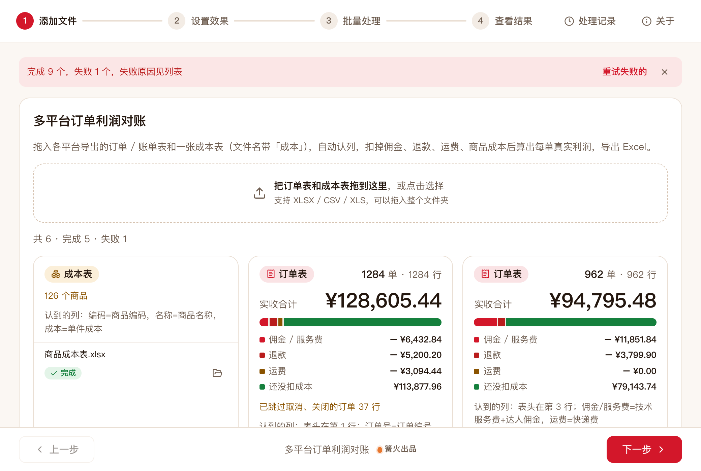

# 多平台订单利润对账

> 篝火出品 · 收录于篝火 App 应用区

导入各平台账单，扣成本、运费、佣金后算真实利润



## 下载

到 [Releases](https://github.com/campfire-code/order-profit-reconciler/releases/latest) 下载对应安装包：

| 电脑 | 文件 |
|---|---|
| Windows 10 / 11 | `order-profit-reconciler_版本号_windows-x64-setup.exe` |
| Mac（Apple 芯片） | `order-profit-reconciler_版本号_mac-arm64.dmg` |
| Mac（Intel 芯片） | `order-profit-reconciler_版本号_mac-x64.dmg` |

第一次打开：
- **Windows**：如果弹出「Windows 已保护你的电脑」，点「更多信息」→「仍要运行」。
- **Mac**：如果提示「无法验证开发者」，打开「系统设置 → 隐私与安全性」，在下方点「仍要打开」。

## 怎么用

1. 准备表格：
   - **订单 / 账单表**：从各平台后台导出的订单表或结算账单（.xlsx 或 .csv，可以一次拖多个，每个文件算一个来源，比如一个平台或一个店铺）。旧版 .xls 请先另存为 .xlsx。
   - **成本表**：自己整理一张表，至少两列：「商品编码」（或「商品名称」）和「单件成本」。**文件名里要带「成本」两个字**，例如 `商品成本表.xlsx`，软件靠文件名区分成本表和订单表（关键字可在参数里改）。
2. 把订单表和成本表一起拖进窗口。
3. 按需设置参数：「每单包装/快递成本」填每单固定多花的钱（一单只扣一次）；默认跳过已取消、已关闭的订单。
4. 点「开始处理」。全部读完后自动生成「利润对账.xlsx」，包含 5 个工作表：
   - **总计**：订单数、实收、佣金、退款、运费、成本、利润、利润率；
   - **订单明细**：每行订单的利润、利润率，找不到成本的行在「备注」里标「缺成本」；
   - **按商品汇总**（按利润从高到低）、**按来源文件汇总**（每个平台/店铺一行，最后是合计）；
   - **列识别**：每个文件认出了哪些列，用来核对。

**计算公式**：每单利润 = 实收 − 佣金/服务费 − 退款 − 运费 − 单件成本 × 数量 − 每单固定成本。金额按「分」计算，没有小数误差。

**自动认列**：按常见中文表头识别，例如订单号（订单编号、子订单号…）、商品名称（商品标题、宝贝标题…）、商品编码（商家编码、SKU…）、数量、实收金额（实收金额、商家实收、买家实付、实付金额、结算金额…）、佣金/服务费（平台佣金、技术服务费、达人佣金…，多列会相加；有「合计」列时只用合计列）、运费（运费、快递费…）、退款金额、订单状态。表格上方有标题行也能自动找到表头。佣金、运费、退款写成负数的账单按绝对值扣。

**认错了怎么办**：打开「手动指定列名」，只填要改的列：
- 填表头名（如 `买家实付`）或列字母（如 `E`）；
- 多列相加用 `+`，如 `技术服务费+达人佣金`；
- 不用某一列填 `无`。比如你选的「实收」已经是扣过佣金的结算金额，就把佣金列填 `无`，避免重复扣；订单表里的「运费」是买家付的邮费而不是你的支出，就把运费列填 `无`。

**注意**
- 各平台导出格式不同、也会变，软件只按表头名字认列，**请先看一眼「列识别」工作表确认**。
- 同一订单有多个商品时，如果平台把整单金额重复写在每一行，会被重复计算，请先在平台导出「按子订单 / 商品行」的明细。
- 订单表和账单表里的同一笔订单不会自动合并去重，同一平台请只拖其中一种。
- 成本先按商品编码匹配，再按商品名称完全一致匹配（忽略空格、大小写、全角半角）。
- 全部在本机完成，不联网、不上传。

## 验收用例

`samples/` 里是虚构的示例数据：`淘宝旗舰店-订单.csv`（5 单，其中 1 单交易关闭、1 单全额退款、1 个商品不在成本表里）、`抖店-十月账单.xlsx`（第 1 行是标题、第 3 行才是表头，有技术服务费和达人佣金两列扣费）、`商品成本表.xlsx`（3 个商品）。

| 操作 | 应得到 |
|---|---|
| 把 `samples/` 里 3 个文件一起拖进窗口，「每单包装/快递成本」填 `3.5`，其他保持默认，点「开始处理」 | 列表里：成本表显示「成本表：3 个商品」；淘宝显示「订单 4 行，跳过已取消 1 行，没认出：佣金/服务费、运费（按 0 计）」；抖店显示「订单 4 行」。提示条显示「已导出 …/利润对账.xlsx：8 单，利润 282.85 元（利润率 42.7%），1 行缺成本，已在明细里标出」 |
| 打开生成的 `利润对账.xlsx` | 「订单明细」8 行，淘宝订单号 `3712024102300010001` 完整保留，利润 71.30、利润率 59.5%；`3712024102300010005`（陶瓷马克杯）备注「缺成本」；抖店 `6930004` 利润 −35.30。「按来源文件汇总」：淘宝旗舰店-订单 164.10，抖店-十月账单 118.75，合计 8 单。「按商品汇总」第一行是 1001 保温杯 500毫升，利润 96.60。「列识别」里抖店一行写着「表头在第 3 行」「佣金/服务费=技术服务费+达人佣金，运费=快递费」 |
| 只拖 `商品成本表.xlsx`，开始处理 | 提示条显示「完成 1 个，失败 1 个，失败原因见列表。收尾失败：没有订单表：除了成本表，还要拖入至少一张平台导出的订单 / 账单表」 |
| 打开「手动指定列名」，「实收金额列」填 `结算金额`，只拖淘宝 CSV 处理 | 该文件失败，原因「找不到列「结算金额」，表头是：订单编号、商品标题、商家编码、购买数量、买家实付金额(元)、订单状态、退款金额」 |

## 自己编译

需要 Node.js 22、pnpm、Rust。

```bash
pnpm install
pnpm test          # 单元测试
pnpm tauri dev     # 开发运行
pnpm tauri build   # 打包
```

界面框架在 `src/kit`（所有 campfire-code 工具共用），本工具的逻辑在 `src/tool`。

## 归属

本工具由**篝火**出品，是篝火 App 应用区收录的开源工具之一，由篝火（GitHub 组织 [campfire-code](https://github.com/campfire-code)）维护与更新。全部工具的目录见 [toolkit-hub](https://github.com/campfire-code/toolkit-hub)。

## 许可证

MIT，版权方为篝火（campfire-code）。
